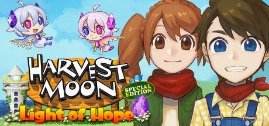

**Harvest Moon: Light of Hope follows a sailor shipwrecked on a damaged island, working to restore the lighthouse and revive the community by farming, befriending villagers, and gathering materials to rebuild what the storm destroyed.**

---

## 📖 About

Harvest Moon: Light of Hope follows a sailor shipwrecked on a damaged island, working to restore the lighthouse and revive the community by farming, befriending villagers, and gathering materials to rebuild what the storm destroyed.

## ⚠️ Problems Without Trainer

| Problem | Status |
|---------|--------|
| **Construction Materials** — Rebuilding all town structures requires gathering specific rare materials | ✅ Solved |
| **Stamina Limits** — Daily stamina restricts how much farming and gathering can be done each day | ✅ Solved |
| **Villager Schedule** — Finding specific villagers for gift-giving requires learning their daily routines | ✅ Solved |
| **Seasonal Requirements** — Lighthouse restoration requires specific season-gated materials | ✅ Solved |

## ✅ Solution

The **Harvest Moon: Light of Hope Trainer** solves all these issues by giving you complete control over the game.

## 🎯 Full Feature List

- Unlimited Resources
- God Mode / Invincibility
- Instant Skill Cooldown
- One-Hit Kill
- Freeze Game Timer
- Unlock All Items & Achievements
- Custom Speed Multiplier
- Save State Anywhere

## 🚀 Quick Start

1. **Disable Windows Defender** temporarily (trainer may trigger false positive)
2. Download the trainer from the button above
3. Launch Harvest Moon: Light of Hope
4. Run the trainer as Administrator
5. Activate desired cheats with hotkeys

## 💎 Free vs Paid

| Feature | Free | Pro |
|---------|------|-----|
| Basic God Mode | ✅ | ✅ |
| Unlimited Resources | ✅ | ✅ |
| All Advanced Cheats | ❌ | ✅ |
| Auto-Updates | ❌ | ✅ |
| Priority Support | ❌ | ✅ |

## 💻 Requirements

- Windows 10/11 (64-bit)
- Harvest Moon: Light of Hope (any version)
- .NET Framework 4.8+
- DirectX 11+

## 🍎 macOS

macOS users can use our alternative tool:

## ⚖️ Legal

This trainer is for educational and single-player use only. Use responsibly.

---

